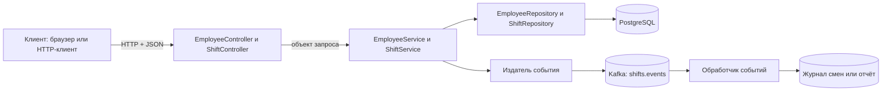
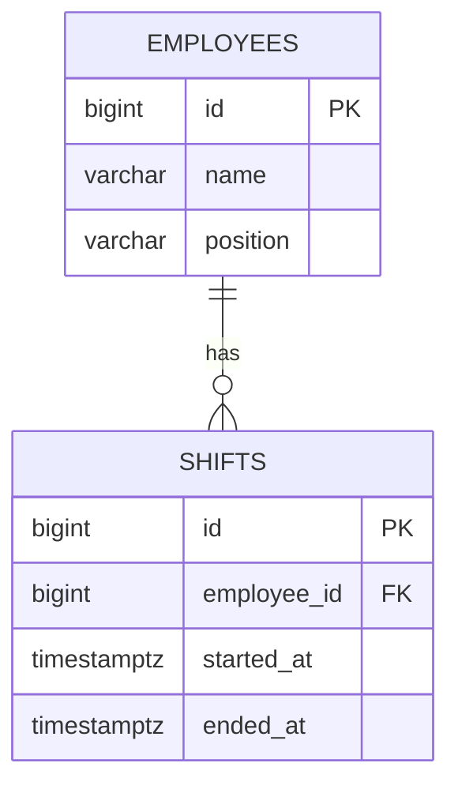
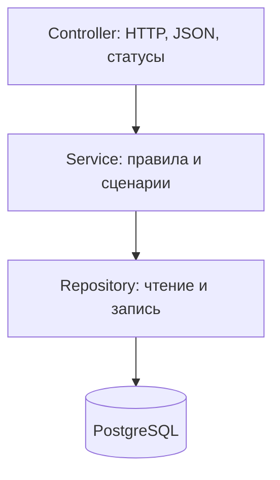

# Учебный проект: Employee Attendance API на Java, Spring Boot, PostgreSQL и Kafka

Этот документ — маршрут от твоего нынешнего Spring-проекта до API учёта сотрудников и их рабочих смен, который можно показать при отклике на junior Java backend. Работай по этапам: каждый следующий добавляет одну новую идею к работающему приложению. Не нужно сначала выучить весь Spring или Kafka.

## 1. Что строим и зачем

Приложение управляет сотрудниками и фиксирует их смены: сотрудник начинает смену, заканчивает её и видит историю отработанного времени. Позже данные сохраняются в PostgreSQL. Kafka передаёт события о завершённых сменах обработчику, который ведёт журнал действий или обновляет отчёт.

**Предположение для учебного проекта:** у сотрудника одновременно может быть только одна активная смена; начало и конец берём по времени сервера. Учёт плановых смен, отпусков, ставок и зарплаты пока не входит в задачу. Эти правила можно изменить, если ты задумал другую модель посещаемости.

Итоговый путь запроса:



**PostgreSQL — источник актуальных данных о сотрудниках и сменах.** Kafka хранит поток событий для других обработчиков; она не заменяет таблицы. Пока работаешь без БД и Kafka, сотрудники находятся в списке `List<Employee>` в памяти, а смены позднее появятся в отдельном временном хранилище.

## 2. Что у тебя уже есть

Я проверил фактический проект в `D:\PROGFOLDERS\employee-attendance-api\main` на 19 октября 2026 года. В `pom.xml` указаны Spring Boot **4.1.1** и Java **25**. Уже подключены Spring Web MVC, Actuator и тестовый Web MVC starter; проект использует Maven Wrapper. Главный класс `MainApplication` лежит в пакете `dev.manuchus.main`.

`EmployeeController` обрабатывает `GET /employees` и `POST /employees`, а `Employee` пока является `record Employee(String name, String position)`. Контроллер хранит записи в `List<Employee>`, поэтому они исчезают после перезапуска и не имеют ID. Сейчас POST проверяет только имя и возвращает сам объект с обычным статусом `200`; проверку должности и ответ `201` ещё предстоит добавить. Файлы `EmployeeService`, `EmployeeRepository`, `Shift`, `ShiftController`, `ShiftService` и `ShiftRepository` существуют, но сейчас **пустые**; не считай их уже реализованными слоями. Текущий тест только проверяет запуск контекста.

Не переделывай всё сразу. Следующий шаг — закончить поведение API в памяти. После этого станет ясно, зачем выносить хранение и правила в отдельные классы.

### Какие зависимости добавлять и когда

Не подключай всё в первый день. Используй сборщик уже существующего проекта (`pom.xml` для Maven или `build.gradle` для Gradle) и совместимые версии, которые предлагает Spring Initializr для твоей версии Spring Boot.

| Этап | Что нужно в сборке | Для чего |
|---|---|---|
| Сейчас | Spring Web MVC, Actuator, Web MVC Test | Уже находятся в твоём `pom.xml`: HTTP-контроллер, технические показатели и старт тестирования. |
| Проверка входа | Validation | Аннотации вроде `@NotBlank` и запуск проверки через `@Valid`. |
| База | Spring Data JPA, PostgreSQL Driver, Flyway (с поддержкой PostgreSQL для Spring Boot 4.1.1) | Репозитории сотрудников и смен, соединение с БД и миграции. |
| Интеграционные тесты | Testcontainers PostgreSQL, если выберешь этот способ | Запуск настоящей тестовой БД в контейнере. |
| События | Spring for Apache Kafka | Producer и consumer событий смен. |

Если зависимость или аннотация не находится, сначала проверь файл сборки и версию Spring Boot, а затем открой документацию именно этой версии.

## 3. Минимальная теория, которая нужна прямо сейчас

| Понятие | Простыми словами | Где появится в проекте |
|---|---|---|
| `record` | Удобный тип для передачи набора значений. Например, имя и должность. | Тело запроса и ответ API. |
| JSON | Текстовый формат обмена данными: `{"name":"Alice"}`. | Между клиентом и контроллером. |
| `@RestController` | Класс, методы которого обрабатывают HTTP-запросы и возвращают данные. | `EmployeeController`. |
| `@RequestBody` | Просит Spring прочитать тело запроса и преобразовать его в Java-объект. | Создание и изменение сотрудника. |
| `@PathVariable` | Берёт значение из пути, например `42` из `/employees/42`. | Получение, изменение и удаление по ID. |
| `@Service` | Помечает класс с правилами приложения. | `EmployeeService`. |
| Внедрение зависимости | Класс получает нужный ему объект через конструктор. | Контроллер получает сервис, сервис — репозиторий. |
| `@Repository` / Spring Data repository | Доступ к данным. | Поиск и сохранение в PostgreSQL. |
| `@Entity` | Класс, который JPA отображает на запись в таблице. | `EmployeeEntity`. |
| Внешний ключ | Связывает строку смены с существующим сотрудником. | `shifts.employee_id → employees.id`. |
| `Instant` и `Duration` | Момент времени и длительность между двумя моментами. | Начало, конец и продолжительность смены. |
| Транзакция | Набор операций с БД, которые должны завершиться согласованно. | Создание/изменение сотрудника. |
| Kafka producer / consumer | Отправитель и получатель событий. | Публикация и обработка `ShiftFinished`. |

**Как это собирается:** `pom.xml` описывает зависимости и сборку Maven. `mvnw.cmd` — Maven Wrapper из самого проекта: он запускает нужную проекту версию Maven, поэтому отдельную команду `mvn` устанавливать не обязательно. Spring Boot при запуске создаёт приложение, настраивает встроенный HTTP-сервер и связывает классы, отмеченные аннотациями Spring. Аннотация сама по себе не выполняет метод: например, `@GetMapping` говорит Spring, какой метод вызвать при подходящем HTTP-запросе. JSON преобразуется в Java-объект при чтении запроса и обратно при формировании ответа.

**Минимум Java для этого проекта:** `List<Employee>` хранит последовательность сотрудников, а `Map<Long, Employee>` позволяет искать сотрудника по ID; у `Map` ключи уникальны. `Optional<Employee>` означает «объект может отсутствовать» и заставляет явно решить, что делать при пустом результате. Интерфейс задаёт доступные методы, а реализация определяет, как они работают: временный репозиторий в памяти и будущий репозиторий БД выполняют одну роль хранения разными способами. Исключение позволяет прервать неудачный сценарий; контроллер или обработчик ошибок переводит известную причину в понятный HTTP-статус. Не пытайся запомнить все коллекции и исключения сразу — закрепляй каждое понятие на конкретном запросе.

**Различай тип и переменную:** в `Employee employee` первое слово — тип, второе — переменная. В `public Employee create(...)` слово `Employee` перед именем метода — тип возвращаемого результата.

**Не смешивай три роли объекта:**

- `CreateEmployeeRequest` — что прислал клиент. В нём нет `id`: сервер назначает его сам.
- `EmployeeEntity` — как запись хранится в БД. Это обычный JPA-класс, а не `record`.
- `EmployeeResponse` — что сервер отдаёт клиенту: `id`, имя, должность.

На раннем этапе допустим один `record Employee`, чтобы сосредоточиться на HTTP. Разделяй модели на три роли, когда подключишь БД: это поможет не отдавать наружу внутренние поля хранения и не принимать от клиента произвольный `id`.

## 4. Контракт API: какое поведение реализовать

Позже приведи маршруты к одному префиксу `/api/employees`. Если сейчас у тебя `/employees`, можно оставить его до окончания первого этапа и сменить одновременно во всех запросах и тестах.

| Запрос | Назначение | Успех | Ошибка |
|---|---|---|---|
| `POST /api/employees` | Создать сотрудника из JSON с именем и должностью. | `201 Created`, JSON с назначенным `id`; желательно заголовок `Location`. | `400` при неверных данных. |
| `GET /api/employees` | Получить список. | `200 OK`, JSON-массив; пустой список — `[]`. | — |
| `GET /api/employees/{id}` | Получить одного по ID. | `200 OK`. | `404`, если такого ID нет. |
| `PUT /api/employees/{id}` | Заменить редактируемые поля. | `200 OK` с обновлённым объектом. | `400` за неверные данные, `404` за неизвестный ID. |
| `DELETE /api/employees/{id}` | Удалить сотрудника без истории смен. | `204 No Content`. | `404` за неизвестный ID; после появления смен — `409`, если история есть. |

После CRUD сотрудников добавь API смен:

| Запрос | Назначение | Успех | Ошибка |
|---|---|---|---|
| `POST /api/employees/{id}/shifts/start` | Начать смену сотрудника по времени сервера. | `201 Created`, смена с `startedAt` и без `endedAt`. | `404` за неизвестного сотрудника; `409`, если активная смена уже есть. |
| `POST /api/shifts/{shiftId}/finish` | Завершить активную смену по времени сервера. | `200 OK`, смена с `endedAt` и длительностью. | `404` за неизвестную смену; `409`, если она уже завершена. |
| `GET /api/employees/{id}/shifts` | Показать историю смен сотрудника. | `200 OK`, список смен. | `404` за неизвестного сотрудника. |

`409 Conflict` означает, что запрос понятен, но противоречит текущему состоянию: нельзя начать вторую смену, пока первая открыта. Для первого варианта отчётности достаточно истории смен; суммарное время за период добавляй после того, как решишь, по какой временной зоне и дате группировать смены.

После появления смен не удаляй сотрудника вместе с историей по умолчанию. Для этого учебного проекта правило такое: если у сотрудника есть хотя бы одна смена, `DELETE` возвращает `409`; позднее можно заменить удаление деактивацией сотрудника. Это сохраняет историю посещаемости и согласуется с внешним ключом в БД.

Для `PUT` договорись, что клиент присылает **оба** редактируемых поля (`name` и `position`), а `id` в пути не меняется. Если нужно частично обновлять одно поле, позже добавь отдельный `PATCH`; не превращай `PUT` в непредсказуемое смешение полной и частичной замены.

Пример создания:

```http
POST /api/employees
Content-Type: application/json

{"name":"Alice","position":"Developer"}
```

Пример ответа после сохранения:

```http
HTTP/1.1 201 Created
Location: /api/employees/42
Content-Type: application/json

{"id":42,"name":"Alice","position":"Developer"}
```

`id` — идентификатор записи. **Индекс `ArrayList` не годится как ID:** после удаления элемента индексы сдвигаются. На этапе в памяти можно хранить `Map<Long, Employee>` и увеличивать счётчик: такой ID остаётся тем же при удалении соседних записей, но сам счётчик и данные пропадут после перезапуска. После подключения PostgreSQL ID будет назначать БД и сохранять между запусками.

Чтобы клиент не присылал себе ID, раздели вход и сохранённый объект уже на этом этапе:

```java
public record CreateEmployeeRequest(String name, String position) {}
public record Employee(long id, String name, String position) {}
```

Это два **отдельных файла**: `CreateEmployeeRequest.java` и `Employee.java`. В Java два публичных типа нельзя объявить в одном исходном файле. `POST` принимает `CreateEmployeeRequest`. Сервер берёт следующий ID, создаёт `Employee` и помещает его в `Map` по этому ID. `GET` и ответ на `POST` возвращают `Employee`. Позже `Employee` в ответе можно переименовать в `EmployeeResponse`, а хранение передать `EmployeeEntity` и репозиторию. Обычный `long`-счётчик здесь годится только для одиночного учебного запуска; одновременно поступающие запросы требуют отдельной синхронизации, поэтому не считай такую реализацию готовой для реального сервера.

Валидация: имя и должность не должны быть `null`, пустой строкой или только пробелами. Сначала проверь это обычным Java-кодом. Позже изучи `@Valid`, `@NotBlank` и зависимость Validation. Важно, чтобы неверный запрос возвращал статус `400`, а не строку `"Empty input"` со статусом `200`.

**Время смены:** храни `startedAt` и `endedAt` как моменты времени (`Instant`), в HTTP передавай ISO-8601 со смещением или `Z` для UTC. `endedAt == null` означает открытую смену. Длительность считай как `Duration.between(startedAt, endedAt)` только для завершённой смены; для отчёта можно возвращать целые минуты. Не рассчитывай длительность вычитанием строк или `double`-часов. Смена может пересечь полночь, поэтому время и локальная календарная дата — разные понятия.

Пример цикла смены (сервер сам назначает время):

```http
POST /api/employees/42/shifts/start
```

```json
{"id":73,"employeeId":42,"startedAt":"2026-10-19T09:00:00Z","endedAt":null}
```

```http
POST /api/shifts/73/finish
```

```json
{"id":73,"employeeId":42,"startedAt":"2026-10-19T09:00:00Z","endedAt":"2026-10-19T17:00:00Z","durationMinutes":480}
```

Здесь время и числа иллюстративные. Реальный ответ будет зависеть от момента запроса; у активной смены `durationMinutes` лучше вообще не отдавать или возвращать `null`, чтобы не выдавать незавершённое значение за окончательное.

У возвращаемого типа метода и HTTP-статуса разные задачи. Если метод контроллера возвращает просто `Employee`, Spring обычно отвечает `200`. Когда нужен `201 Created` и заголовок `Location`, метод может возвращать `ResponseEntity<Employee>`: внутри него находятся и статус, и заголовки, и тело `Employee`. Для ошибки неизвестного ID можно выбросить `ResponseStatusException` со статусом `404`. После ручной проверки входа переходи к `record CreateEmployeeRequest(@NotBlank String name, @NotBlank String position)` и параметру `@Valid @RequestBody CreateEmployeeRequest request`; для этого должна быть подключена зависимость Validation.

### Как проверять API без дополнительной программы

Запусти приложение из IDE или из PowerShell: `.\mvnw.cmd spring-boot:run` для Maven Wrapper либо `.\gradlew.bat bootRun` для Gradle Wrapper. Из другой вкладки PowerShell отправь запросы; если пока оставил путь `/employees`, замени им `/api/employees`:

```powershell
$apiUrl = 'http://localhost:8080/api/employees'
Invoke-RestMethod -Method Post -Uri $apiUrl -ContentType 'application/json' -Body '{"name":"Alice","position":"Developer"}'
Invoke-RestMethod -Method Get -Uri $apiUrl
Invoke-RestMethod -Method Get -Uri "$apiUrl/1"
```

Для ошибок важен **HTTP-статус**, а не только текст ответа. `Invoke-RestMethod` на `400`/`404` покажет ошибку; статус удобно смотреть в HTTP-клиенте или в объекте исключения PowerShell. При проверке сохраняй и удачные примеры, и запросы с пустым именем или неизвестным ID.

## 5. Как организовать код

На маленьком этапе можешь держать `EmployeeController.java` и `Employee.java` в одном пакете. Когда появятся сервис и БД, раскладывай по назначению. Пример структуры:

```text
src/
├── main/
│   ├── java/dev/manuchus/main/
│   │   ├── MainApplication.java
│   │   ├── employee/
│   │   │   ├── api/
│   │   │   │   ├── EmployeeController.java
│   │   │   │   ├── CreateEmployeeRequest.java
│   │   │   │   ├── UpdateEmployeeRequest.java
│   │   │   │   └── EmployeeResponse.java
│   │   │   ├── application/
│   │   │   │   └── EmployeeService.java
│   │   │   └── persistence/
│   │   │       ├── EmployeeEntity.java
│   │   │       └── EmployeeRepository.java
│   │   └── shift/
│   │       ├── api/
│   │       │   ├── ShiftController.java
│   │       │   └── ShiftResponse.java
│   │       ├── application/
│   │       │   └── ShiftService.java
│   │       ├── persistence/
│   │       │   ├── ShiftEntity.java
│   │       │   └── ShiftRepository.java
│   │       └── event/
│   │           ├── ShiftFinishedEvent.java
│   │           ├── ShiftEventPublisher.java
│   │           └── ShiftEventListener.java
│   └── resources/
│       ├── application.yml
│       └── db/migration/
│           ├── V1__create_employees.sql
│           └── V2__create_shifts.sql
└── test/java/dev/manuchus/main/
    ├── employee/EmployeeServiceTest.java
    └── shift/ShiftServiceTest.java
```

Путь папок после `src/main/java` должен соответствовать строке `package` в Java-файле. Сейчас в проекте уже есть пустые классы `EmployeeService`, `EmployeeRepository` и четыре заготовки `Shift`: наполняй или преобразовывай их по этапам; при переносе в подпакеты обновляй `package` и импорты через IDE. Схема выше — **целевая**, не команда создать все файлы сегодня.

Схема данных после подключения PostgreSQL:



У одного сотрудника может быть много смен. Каждая смена принадлежит ровно одному сотруднику. Пока `ended_at` отсутствует, смена активна. На уровне БД позже добавь ограничение, которое не позволяет двум открытым сменам иметь одного `employee_id`; проверка только в Java не защищает от двух одновременных запросов.

Распределение ответственности:



- **Controller** принимает запрос, вызывает сервис и формирует HTTP-ответ. Здесь не должно быть SQL и длинной бизнес-логики.
- **Service** решает, существует ли сотрудник, можно ли его изменить, что сохранить и какое событие создать. Зависимости передаются через конструктор.
- **Repository** занимается доступом к данным. В первой версии это может быть твой `Map` в памяти; затем — Spring Data JPA.

### Что происходит при одном POST-запросе

1. Клиент отправляет HTTP-запрос с `Content-Type: application/json`.
2. Spring выбирает метод по `@PostMapping`, читает JSON через `@RequestBody` и создаёт `CreateEmployeeRequest`.
3. Проверка ввода отклоняет пустое имя или должность. Это ошибка клиента — `400`.
4. Контроллер передаёт данные сервису. Контроллеру не нужно знать, как устроена таблица.
5. Сервис создаёт `EmployeeEntity` и вызывает репозиторий. Репозиторий сохраняет запись и возвращает её с ID.
6. Сервис составляет `EmployeeResponse`; контроллер возвращает `201` и адрес новой записи.
7. Spring преобразует `EmployeeResponse` в JSON. Для клиента Java-классы и структура пакетов невидимы.

Spring создаёт контроллеры, сервисы и репозитории как управляемые объекты (*beans*) и передаёт зависимости через конструкторы. Поэтому сервис не создают вручную через `new EmployeeService(...)` внутри каждого HTTP-метода. Это также позволяет подменить репозиторий в тесте.

В контроллере это выглядит так (остальные методы здесь опущены):

```java
private final EmployeeService service;

public EmployeeController(EmployeeService service) {
    this.service = service;
}
```

Spring передаст созданный им `EmployeeService` в конструктор. Контроллер вызывает методы сервиса, а не создаёт новый сервис при каждом запросе.

Класс с `@SpringBootApplication` держи в общем родительском пакете `dev.manuchus.main`: при стандартной настройке Spring ищет компоненты в этом пакете и его подпакетах. В твоём проекте `MainApplication` уже расположен правильно. Если перенести главный класс глубоко внутрь `employee.api`, сервис и репозиторий могут не попасть в поиск.

`record` удобен для `CreateEmployeeRequest` и `EmployeeResponse`: они представляют значения, передаваемые между слоями. JPA-сущность хранит изменяемое состояние и отображается на таблицу, поэтому для `EmployeeEntity` используй обычный класс. Поля entity не следует автоматически считать полями публичного ответа: завтра в таблице могут появиться внутренние сведения, которые клиенту не нужны.

Для JPA это ещё и техническое требование: entity должна быть нефинальным классом с публичным или защищённым конструктором без аргументов; Java `record` entity быть не может. У entity будет `@Id`, а для ID, выдаваемого БД, обычно задают `@GeneratedValue`. Spring Data repository для неё в простом случае выглядит как `EmployeeRepository extends JpaRepository<EmployeeEntity, Long>`: первый параметр — тип сущности, второй — тип её ID. Методы `save`, `findById`, `findAll` и `deleteById` дают базовые операции; `findById` возвращает `Optional`, поэтому отсутствие записи нужно обработать, а не бездумно вызывать `.get()`. [Требования Jakarta Persistence к entity](https://jakarta.ee/specifications/persistence/3.2/apidocs/jakarta.persistence/jakarta/persistence/entity).

### Что означает «сохранить в БД»

В памяти `data.add(employee)` меняет состояние только работающего Java-процесса. При работе с PostgreSQL репозиторий отправляет операции в БД. Таблица имеет первичный ключ `id`, а БД сохраняет строки между запусками приложения. JPA помогает сопоставлять Java-объекты и строки таблицы, но базовый SQL всё равно нужен: умей самостоятельно объяснить, какие `INSERT`, `SELECT`, `UPDATE` и `DELETE` стоят за методами API.

Транзакция нужна, когда несколько изменений данных образуют одну операцию. Если одно из них не удалось, изменения БД должны откатиться вместе. В Spring такие сценарии обычно располагают в сервисе, где задают границу транзакции. Отправка сообщения в Kafka не становится частью транзакции PostgreSQL автоматически — поэтому на позднем этапе указан outbox.

Для смены это особенно заметно: `start` сначала проверяет отсутствие активной смены, затем создаёт её. При двух одновременных запросах оба потока могут пройти Java-проверку. Поэтому на этапе БД проверка остаётся в сервисе ради понятной ошибки, а частичный уникальный индекс служит последней защитой. Ошибку нарушения **именно этого** ограничения переводи в `409`, не скрывая все ошибки БД под одним статусом. Завершение смены тоже делай в транзакции: повторный `finish` должен увидеть уже заполненное `endedAt` и не создать новое событие.

## 6. Этапы реализации

### Этап 1. Доделать API в памяти

**Изучить:** `Map<Long, Employee>`, проверку отсутствия записи, `@PathVariable`, HTTP-статусы `200/201/204/400/404`, `ResponseEntity` и `ResponseStatusException`.

**Сделать:** оставить свой POST и GET списка; добавить серверный ID, GET по ID, PUT и DELETE; проверить пустые имя и должность. Пока данные хранятся в памяти, это учебный этап. Если хочется, вынеси хранение из контроллера в `EmployeeService` уже сейчас.

**Готово, когда:** два POST создают разные ID; GET каждого возвращает нужную запись; неизвестный ID даёт `404`; неверное имя даёт `400`; удаление одного не меняет ID другого.

Это временная учебная реализация. Поле `ArrayList`/`HashMap` внутри контроллера разделяется между запросами, не сохраняется после перезапуска и требует отдельного внимания к одновременным обращениям. Постоянное хранение перенесём в БД, а контроллер оставим без изменяемого состояния.

### Этап 2. Учёт смен в памяти

**Изучить:** `Instant`, `Duration`, состояние объекта (смена открыта или завершена), поиск по `employeeId`, HTTP-статус `409 Conflict`.

**Сделать:** наполнить существующие заготовки `Shift`, `ShiftController`, `ShiftService` и временный `ShiftRepository`. Сервис проверяет, что сотрудник существует, что у него нет другой активной смены, и только затем создаёт новую. Завершение записывает `endedAt` и считает длительность. Для первого прохода можно использовать `Instant.now()`; когда начнёшь тестировать время, передавай `Clock` через конструктор, чтобы тесты не зависели от реальных часов. В тесте задавай разные моменты начала и конца: если оба вызова используют один и тот же неподвижный `Clock`, длительность окажется нулевой.

**Готово, когда:** начало и конец смены доступны по HTTP; завершённая смена показывает положительную длительность; второй `start` до `finish` даёт `409`; повторный `finish` даёт `409`; неизвестный сотрудник даёт `404`; история возвращает смены нужного сотрудника.

### Этап 3. Java и тесты вокруг работающего поведения

**Изучить:** интерфейсы, коллекции, `equals/hashCode`, исключения, `record`, основы generics, JUnit. Не нужно откладывать весь проект ради алгоритмических задач: разбирай Java по мере её применения в нём.

**Сделать:** вынести правила сотрудников в уже созданный `EmployeeService`, а правила смен — в `ShiftService`; написать несколько полезных тестов. Проверять реальные сценарии: успешное создание, пустое имя, неизвестный ID, обновление, удаление, двойное начало смены и повторное завершение.

**Готово, когда:** тесты запускаются одной командой через wrapper твоего сборщика. В PowerShell это обычно `.\mvnw.cmd test` для Maven или `.\gradlew.bat test` для Gradle.

### Этап 4. PostgreSQL, SQL и JPA

**Изучить:** таблица, строка, первичный ключ, `SELECT/INSERT/UPDATE/DELETE`, ограничение `NOT NULL`, транзакция, JPA entity, `JpaRepository`.

**Сделать:** поднять PostgreSQL локально; создать таблицы `employees` и `shifts`; настроить адрес БД и учётные данные через `application.yml` и переменные окружения; добавить `EmployeeEntity`, `ShiftEntity` и репозитории; заменить хранение в памяти; отделить объекты API от объектов БД. Схему меняй миграциями, например Flyway: файлы миграций хранятся в Git и воспроизводят структуру БД. Пароль в Git не записывай. Когда Flyway управляет схемой, не полагайся одновременно на автоматическое создание таблиц Hibernate; проверяй соответствие entity и миграций.

Первая миграция для PostgreSQL может выглядеть так:

```sql
CREATE TABLE employees (
    id BIGINT GENERATED BY DEFAULT AS IDENTITY PRIMARY KEY,
    name VARCHAR(120) NOT NULL,
    position VARCHAR(120) NOT NULL
);
```

При Flyway этот SQL лежит в `src/main/resources/db/migration/V1__create_employees.sql`. Следующее изменение схемы — новый файл `V2__...sql`, а не переписывание уже применённого `V1`. Историю таких изменений можно воспроизвести на другой машине. [Как Spring Boot запускает миграции](https://docs.spring.io/spring-boot/how-to/data-initialization.html).

`V2__create_shifts.sql` может содержать:

```sql
CREATE TABLE shifts (
    id BIGINT GENERATED BY DEFAULT AS IDENTITY PRIMARY KEY,
    employee_id BIGINT NOT NULL REFERENCES employees(id),
    started_at TIMESTAMPTZ NOT NULL,
    ended_at TIMESTAMPTZ,
    CONSTRAINT shifts_valid_interval CHECK (ended_at IS NULL OR ended_at > started_at)
);

CREATE UNIQUE INDEX one_open_shift_per_employee
    ON shifts (employee_id) WHERE ended_at IS NULL;
```

Внешний ключ запрещает смену без сотрудника. `ended_at` может быть `NULL`, пока смена активна. Проверка запрещает отрицательную или нулевую длительность. Частичный уникальный индекс защищает правило «одна активная смена» даже при двух одновременных запросах. На первом шаге `ShiftEntity` может хранить `Long employeeId`; сложную JPA-связь `@ManyToOne` изучишь позже. [О частичных уникальных индексах в PostgreSQL](https://www.postgresql.org/docs/current/indexes-partial.html).

Перед JPA выполни несколько SQL-запросов вручную: создай сотрудника, создай ему смену, найди все его смены через `WHERE employee_id = ...`, закрой смену через `UPDATE` и попробуй создать вторую открытую смену. Так ограничения перестанут быть «магией аннотаций». Затем проверь, что `JpaRepository<EmployeeEntity, Long>` выполняет тот же смысл: `save` создаёт или обновляет, `findById` может не найти запись, а `findAll` читает список. Метод для истории смен можно выразить запросом репозитория по `employeeId`, но сначала проверь, какую SQL-операцию он выполняет.

**Готово, когда:** сотрудники и завершённые смены остаются после перезапуска приложения; запросы по ID и обновление читают актуальные данные из БД; повторный старт смены отклоняется даже при двух почти одновременных запросах; тесты проходят.

### Этап 5. Тесты HTTP и БД

**Изучить:** разницу между unit-тестом и интеграционным тестом, MockMvc, изоляцию тестовых данных.

**Сделать:** проверить API как HTTP: статус, JSON, ошибки. Для репозитория и миграций добавить интеграционные тесты с отдельной тестовой БД; контейнер PostgreSQL через Testcontainers — удобный вариант после того, как обычные тесты понятны.

| Вид проверки | Что именно проверять | Что понадобится |
|---|---|---|
| Unit-тест сервиса | Правило: пустое имя отклоняется, неизвестный ID обрабатывается, сохранённый объект возвращается. | JUnit и подставной репозиторий; HTTP-сервер и БД не нужны. |
| Тест контроллера | Маршрут, статус, входной и выходной JSON. | MockMvc и изолированные зависимости контроллера. |
| Интеграционный тест БД | Миграция создала таблицу, репозиторий действительно сохраняет и читает запись. | Отдельная PostgreSQL, например через Testcontainers. |
| Тест событий | После **завершения смены** публикуется `ShiftFinished`; повторный `eventId` не дублирует журнал. | Сначала тест логики с подставными зависимостями, затем интеграционный запуск Kafka. |

**Готово, когда:** тест на `POST` сотрудника проверяет `201` и созданный ID; `GET` неизвестного ID — `404`; неверный JSON или пустое имя — `400`; тест БД подтверждает сохранение и повторное чтение сотрудника и смены; тесты правил смен проверяют `409`.

### Этап 6. Kafka с реальным смыслом

Добавляй Kafka **после** работающего API смен и БД. Сценарий: после завершения смены публиковать `ShiftFinished`, а обработчик события записывает факт в журнал или обновляет отчёт по отработанному времени. Сначала producer и consumer могут жить в одном приложении; разделять их на два сервиса для обучения не требуется.

**Изучить:** topic, сообщение, ключ, partition, producer, consumer group, offset, повторная доставка. Событие должно описывать свершившийся факт, например `ShiftFinished`, и содержать `eventId`, `shiftId`, `employeeId`, время окончания и нужные обработчику данные.

**Сделать:** отправлять событие в topic `shifts.events` с ключом `employeeId`; добавить consumer и журнал обработанных событий; проверить повторное получение одного `eventId`. Kafka может доставить сообщение повторно, поэтому обработчик должен переносить дубликаты без двойного действия (*идемпотентность*).

Пример содержимого события (форму полей зафиксируй в README):

```json
{"eventId":"8d4d5b06-8b1f-4c81-91e2-f240c92bcd77","type":"SHIFT_FINISHED","shiftId":73,"employeeId":42,"endedAt":"2026-10-19T18:00:00Z","durationMinutes":480}
```

`topic` — именованный поток; `partition` — его часть. Сообщения с одним ключом `employeeId` обычно попадают в одну partition, так что события одного сотрудника можно читать по порядку; общего порядка между всеми partition нет. `offset` — позиция сообщения внутри partition, по которой consumer продолжает чтение. При сбое до фиксации обработки сообщение может прийти снова. Для журнала действий сделай `event_id` уникальным в таблице `shift_audit`: повторный `eventId` не должен создать вторую запись или повторно увеличить сумму минут. Сначала разберись с этой схемой, затем изучай настройки повторов и подтверждения обработки. [Введение в Kafka: ключи, partition и порядок](https://kafka.apache.org/documentation/index.html).

Минимальный обработчик получает JSON, проверяет его обязательные поля, записывает `eventId` и сведения о смене в `shift_audit`, а только после успешной записи считает сообщение обработанным. Уникальность `event_id` закрепи в БД, иначе проверка «такое событие уже было» снова сломается при параллельной обработке. Если тот же ID пришёл повторно, обработчик не меняет отчёт второй раз. Версию формата события и правила изменения полей запиши в README: producer и consumer должны одинаково понимать JSON.

**Важная граница:** сохранение в PostgreSQL и отправка в Kafka — две разные операции. Простой вариант годится для первой демонстрации, но может дать несогласованность при сбое между ними. После рабочего примера изучи *transactional outbox*: событие записывается в ту же БД-транзакцию, а отдельный процесс публикует его в Kafka.

**Готово, когда:** завершение смены сохраняется в БД, событие появляется в topic, обработчик пишет одну запись в журнал, повторное сообщение не создаёт дубль.

### Этап 7. Подготовка проекта к показу

**Сделать:** добавить `README.md` с назначением проекта, схемой, инструкцией запуска, примерами запросов и командами тестов; поднять PostgreSQL и Kafka через Docker Compose; хранить пароль и адреса сервисов в настройках окружения, а не в исходниках; сделать понятные Git-коммиты. Проверь `git status` в корне `main`: при моём просмотре эта папка не была Git-репозиторием. Если это по-прежнему так, инициализируй Git до публикации проекта, добавь `.gitignore` для `target/`, локальных настроек и секретов, а затем сделай первый коммит.

**Готово, когда:** проект можно клонировать, запустить по инструкции, создать сотрудника, начать и закончить смену, увидеть событие и запустить тесты. В README честно укажи ограничения, например отсутствие авторизации, если её ещё нет.

После основных этапов можно добавить поиск и пагинацию списка, простую авторизацию через Spring Security, журналирование ошибок и CI, который запускает тесты при каждом изменении. Это улучшит демонстрационный проект, но не мешает начать откликаться, когда базовый API, БД, тесты и README уже готовы.

## 8. Как заниматься по 2–4 часа в день

На одну учебную сессию бери **одну проверяемую функцию**, например «GET по ID возвращает 404, если записи нет». Пример распределения двух часов: 25 минут теория и документация, 75 минут код, 20 минут проверка и запись ошибок. При четырёх часах добавь тесты и самостоятельный повтор без подсказок.

Для каждой функции повторяй цикл:

1. Запиши ожидаемый запрос и ответ (статус + JSON).
2. Реализуй минимальный рабочий код.
3. Проверь успешный случай и хотя бы одну ошибку.
4. Объясни своими словами, какой класс за что отвечает.
5. Сохрани изменение отдельным Git-коммитом.

Если застрял, сначала читай текст ошибки и документацию **ровно того метода или аннотации**, на котором остановился. Переписывание готового проекта целиком создаёт иллюзию понимания; небольшой проверенный шаг лучше.

Ориентир по неделям при 2–4 часах в день (это не дедлайн: переходи дальше по критерию «Готово, когда»):

| Период | Главный результат | Что объяснить без подсказки |
|---|---|---|
| 1–2-я недели | CRUD сотрудников и смены в памяти. | Почему ID не равен индексу массива; зачем `Service`; чем `400`, `404` и `409` отличаются. |
| 3-я неделя | Тесты правил и HTTP, понимание основных коллекций и `Optional`. | Как проверить ошибку и успешный путь; почему тест времени использует управляемый `Clock`. |
| 4–5-я недели | PostgreSQL, миграции, JPA и тест БД. | Как внешний ключ и индекс защищают данные; что делает транзакция; какой SQL стоит за запросом. |
| 6-я неделя и далее | Kafka, README и демонстрация. | Почему событие возможно получить дважды; что такое `eventId`; где возникает риск между БД и Kafka. |

Если этап занимает дольше, это нормально. После каждой недели попробуй заново написать один небольшой кусок без просмотра готового решения: например, `GET` по ID, тест на второй `start` или SQL для истории смен. Если можешь объяснить поведение и восстановить его, знание закрепилось. Для отклика на junior позицию приготовь короткий рассказ о проекте: какой запрос приходит, куда он проходит, как данные сохраняются, что проверяют тесты и зачем здесь Kafka. Алгоритмические задачи оставь как отдельную практику на 20–30 минут в некоторые дни; они не заменяют этот проект.

## 9. Порядок чтения и официальные материалы

Используй документацию как справочник по текущему этапу, а не читай всё подряд:

1. Java: [основы языка, ООП, generics и коллекции](https://dev.java/learn/).
2. Spring MVC: [первый REST-сервис](https://spring.io/guides/gs/rest-service/) и [справочник Spring Boot Web](https://docs.spring.io/spring-boot/reference/web/servlet.html).
3. Валидация: [пример Spring](https://spring.io/guides/gs/validating-form-input/); пример про формы, но он объясняет сам механизм валидации. Для JSON изучай `@Valid @RequestBody` в [документации Spring MVC](https://docs.spring.io/spring-framework/reference/web/webmvc/mvc-controller/ann-methods/requestbody.html).
4. SQL и JPA: [учебник PostgreSQL](https://www.postgresql.org/docs/current/tutorial.html), [ограничения и внешние ключи](https://www.postgresql.org/docs/current/ddl-constraints.html), [Spring Data JPA guide](https://spring.io/guides/gs/accessing-data-jpa/), [документация Flyway](https://documentation.red-gate.com/fd/flyway-documentation-138346877.html).
5. Тесты: [Spring Testing the Web Layer](https://spring.io/guides/gs/testing-web/).
6. Kafka: [Apache Kafka Quickstart](https://kafka.apache.org/quickstart/) и [Spring for Apache Kafka](https://docs.spring.io/spring-kafka/reference/).
7. Локальный запуск инфраструктуры: [Docker Compose](https://docs.docker.com/compose/).

Смотри документацию той версии Spring Boot и зависимостей, которая указана в твоём `pom.xml` или `build.gradle`. Примеры на сайтах со временем обновляются.

## 10. Ближайшая задача

Вернись к текущему коду. Добавь `CreateEmployeeRequest` без ID и `Employee` с ID, замени список на `Map<Long, Employee>` и реализуй `GET /employees/{id}`. Пока используй существующий маршрут `/employees/{id}`; к единому префиксу `/api` перейдёшь после первого этапа. Проверь три случая: существующий сотрудник → `200`, неизвестный ID → `404`, список из двух сотрудников → каждый доступен по своему ID. После этого переходи к `PUT` и `DELETE`.
